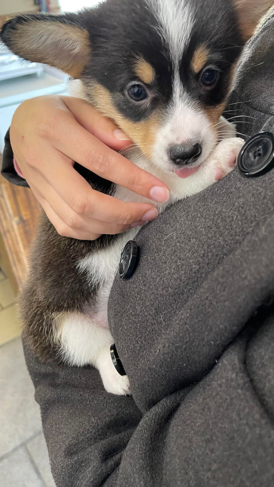

I am an Associate Professor of Statistics (and data science) at [Cornell College](https://www.cornellcollege.edu/) and Director of Cornell Summer Research Institute [(CSRI)](https://www.cornellcollege.edu/research/cornell-summer-research-institute.shtml). I received my PhD in Statistics and Analytics at Central Michigan University. During my PhD I also studied mathematics and statistics education. My dissertation work involved creating a new lack of fit test for linear regression models. 

My interests are broadly in statistics education and data science. Active collaborations and projects:

- Working with undergraduate students in teaching, advising, and overseeing undergraduate research

- Building text analysis tools to support the Scottish Gaelic language ([About](https://scottish-gaelic-collab.github.io/lemmatizer_gaelic/))

- [Community Engaged Statistics and Data Science](https://community-engaged-stats-ds.github.io/CESDS_website/)

- Creating, testing, and studying the impact of educational board games in statistics classrooms

- Developing and teaching (and soon studying) a study abroad course on this history of statistics in the British Isles

::::: columns
::: column
<i class="bi bi-twitter-x" aria-hidden="true"></i> [stats_tgeorge](https://x.com/stats_tgeorge)

<i class="bi bi-bluesky" aria-hidden="true"></i> [stats-tgeorge.bsky.social](https://bsky.app/profile/stats-tgeorge.bsky.social)

 <a href="mailto:tgeorge@cornellcollege.edu"> tgeorge\@cornellcollege.edu </a>

 [stats-tgeorge](https://github.com/stats-tgeorge)

 [Page Source](https://github.com/stats-tgeorge/personal_website)

 Office: West 311

**Students:** See your course syllabus for current office hours or email Professor George at [tgeorge\@cornellcollege.edu](mailto:tgeorge@cornellcollege.edu).
:::

::: column

:::
:::::

## Family

My wife, Alyx, and our three dogs, Jennabell, Mocha, and Macchiato, live in small town in Iowa. Yes, I do love corn and snow!

::: {layout-ncol="2"}

:::
