This is my first post so; hopefully you find it interesting. This fall, I went on a trip to plan a study aboard course on the history of statistics (and its use/applications) in the UK and Ireland. The trip was supported by the Gaarde-Morton Junior Faculty Award at Cornell College and the American Statistical Association (ASA) section of Statistics and Data Science Education. I am very thankful of their contributions and believe the abroad course that I will offer on this topic is going to be an amazing experience for the students. The blog post is my telling of what I did while on that trip, to both help myself remember but also share some of the fun things that will be included in the future course. The trip was 14 days long, and the most logical way to tell it is in order by day. Before that though, there was planning, emails, planning, emails and so fourth.

Planning was, well very boring, but obviously necessary. My college has a unique schedule where each course happens in 18 days. This is relevant because it meant I needed to take this trip in December of this year during the part of the year I was not teaching. I really only knew how much funding I would have around the start of November while I was teaching an 18 day course....planning had to happen quick. Luckily, I had already been asked to provide a basic syllabus, itinerary, and budget for the course (that took months to prepare) before I knew for sure I was going on this planning trip.

I worked out the travel details and emailed numerous institutions and organizations within a few weeks. You might know this, but faculty don't always respond to emails particularity quickly, so I needed my trip to have a lot of flexible time to allow meetings to get scheduled last minute. More on what I did below but for someone who has only been abroad twice before, and mostly hired other a company to plan or was at conferences, this was already a great learning experience.

What did I do?

#### Day 1

Well, travel of course! Since I fail to sleep on airplanes I arrived in Dublin, Ireland at about 8am and really needed to use that day to its fullest extent - regardless if I had not slept in over 24 hours already. The bus sitution in Dublin is a little bit of a mess. I had bought an unlimited travel card called Leap card. I immediately found out when waiting for bus in the cold that part of the public transportation in Dublin has recently been privatized so my card only worked on rather specific buses. Finding the right bus was also a challenge but eventually I found the right one about two to three blocks from the airport along an odd winding sidewalk with limited signage.

I made it to my hotel; Academy Plaza, a bit of a hidden gem, a block of a main stretch of the city, quite nice and rather cheap. Thankfully they happened to have my room ready at 11am which was amazing. I relaxed briefly and headed over to EPIC Emigration Museum. This was one of the many locations that was a question mark - should it or should it not be in the course? My review: Smaller museum that is rather new and has some interactive elements. They hide most data collection/use behind the scenes so if I include this in the course it it will be more for Irish history that anything specifically related to statistics. I ended this very long day with a walk around the part of the city I was in and then rested the remainder of the day. I wished I would have done more but as I closed in on 44 hours of no sleep I decided I was in fact a human and humans are supposed to sleep (for some reason).

::: columns
::: {.column width="70%"}
#### Day 2

This day I realized how many museums in this city don't really open until 10am. I had a scheduled meeting with a faculty member, and Central Statistics Office of Ireland employee, Professor Shane Whelan, at 11am at University College Dublin. It took about an hour via bus to make it to their campus. The campus was really amazing, and my meeting with Shane went swimmingly. Shane is a long term member of the Statistical and Social Inquiry Society of Ireland (SSIS) which is the 2nd longest existing society in the UK focuses on statistics. Shane has authors works on the organization which dates back to 1847. Shane agreed to offer a talk to my students (hurrah) to speak about the SSIS and his own long history as an actuary in Ireland. He also showed me to UCD's sciences building that was massive and really beautiful.

I made it back to downtown Dublin around 2 pm and made my way over to the Dublin Castle. This castle is mostly been rebuilt over the years and actually still functions with some government operations. The tour was very nice and the history goes back over 1000 years. Another event that I will plan for the course that will not be related to the history of statistics but give some of Ireland's rich history. I finished off the day by planning a bit of an impromptu day in Belfast I'll talk about next. When I visit Dublin with students we will be visiting, touring, and getting a special talk at Guinness Brewery (where William S. Gosset worked). Guinness has said they will do this but I couldn't ask them to create it for just me yet, 8 months in advance. Since I knew for sure we would be doing that in the future I decided to use was my last day in Dublin to explore a maybe for the course: the Titanic Museum Belfast.

:::

::: {.column width="30%"}

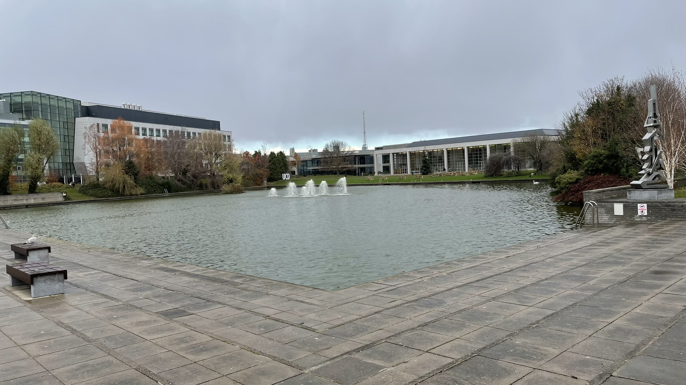

:::
:::

::: columns
::: {.column width="70%"}
#### Day 3

Like I mentioned, I decided to go to Belfast. I found a tour that left from Dublin, would bus me to Belfast, go to the Giants Causeway (PHOTO), dark forest (PHOTO), and the Titanic Museum Belfast (PHOTO). I made the right decision. Easily my favorite museum of all time. This museum has multiple terminals where you can uses dashboards to look. Every room is designed uniquely. It is 4 floors and the first floor is general history followed by 3 floors about all things Titanic. The museum stands at the base of the pier/dock Titanic was launched from. The museum has a basic short roller coaster.....yes a roller coaster....why? Idk, was it very fun, absolutely. You may wonder, what did we think of Titanic? Well, a freely available and commonly used dataset for learning logistic regression is on the Titanic passengers. The only course prerequisite will be intro stats which does not cover logistic but most students we expect to come along will have taken our 2nd course in statistics already which does. Most likely I will create a two piece activity for that museum. The first will be a statistical analysis, using intro stat tools, of the data publicly available. The second will be some use of the different data-centric exhibits. This maybe isn't what you envisioned when I started talking about the history of statistics, but, the reality is if you look more than 200 years back, people did statistics without calling it statistics. The Titanic disaster is certianly history and statistics was used in both all of the financing of the creation and the engineering that went into building it.

The other stops on the tour were just for fun and part of the tour. I enjoyed them immensely and the Giants Causeway is one of the most beautiful places I have every stood in my life.

That night I took a plane from Belfast to Edinburgh, Scotland, and made it to the Kickass Grassmarket Hostel (yes hostel) around midnight. I am considering this hostel for my students, and I had never stayed at any hostel, so I thought I better experience it for myself.

:::

::: {.column width="30%"}

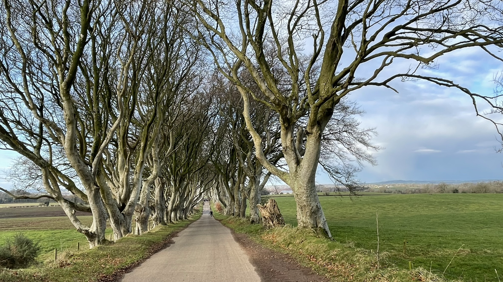

:::
:::

::: {#fig layout-ncol=2}

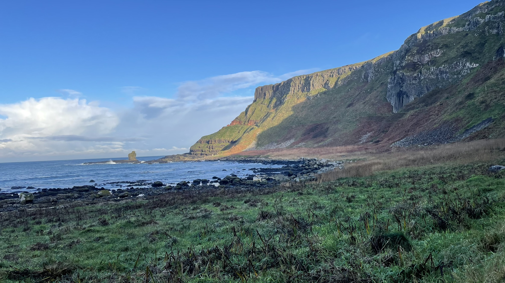

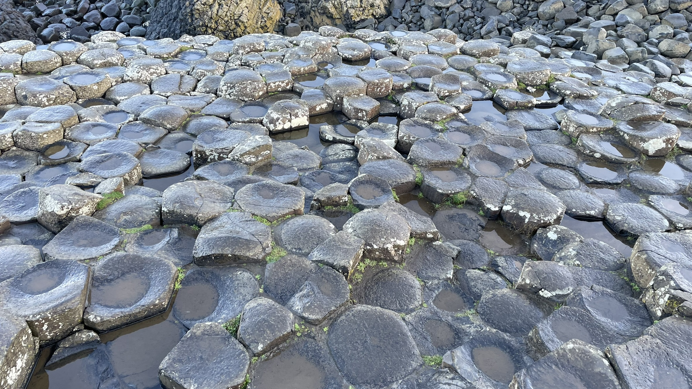

Giants Causeway
:::

::: {#fig layout-ncol=2}

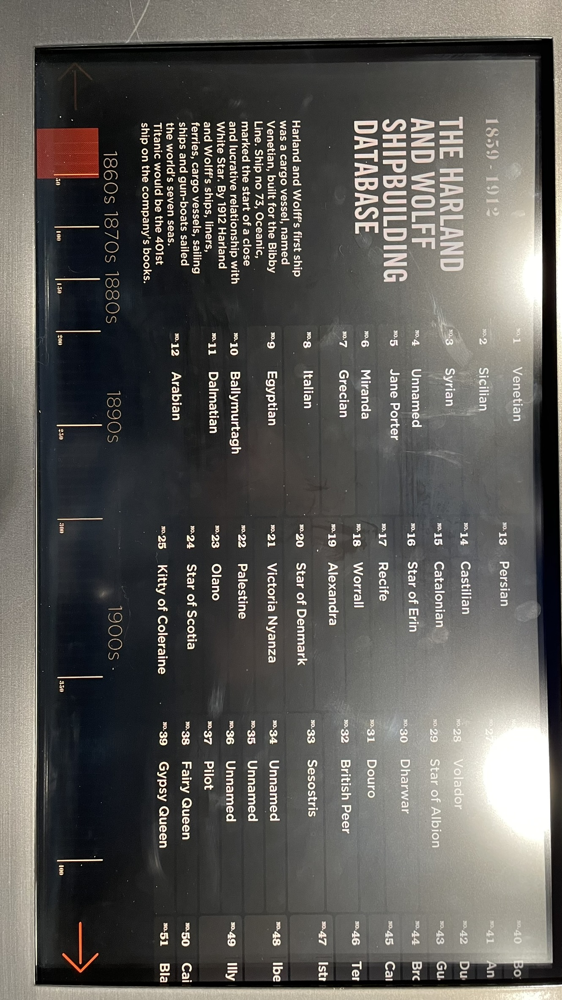

Titanic Museum
:::

::: columns
::: {.column width="70%"}

#### Day 4 (Saturday)

I crawled out of bed, almost literally, the next morning around 9am. I had walked 10 miles the previous day and had only gotten 2 hours of sleep the night before (darn nerves). Non-the-less, there was things to do! I quickly discovered limits on visiting on hours - most museums in the UK are 10-4 or 10-4:30. This generally meant I could only visit two a day if I was collecting enough information to create a class based on the exhibits.

University of Edinburgh - The Data Lab. One idea for the course is to include modern uses of statistics in the course (as soon as I right this it is technically history). The Data Lab does consulting for both academic and non-academic research and are willing to present something to my students (to be decided when we meet). I had planned to meet with them but they had to cancel last minute. I did still stop by and see that amazing building and robotics lab housed within it. I'll be following up them via Zoom.

National Museum of Scotland. This museum happens to be one I have visited before but of course I remembered almost nothing. I did not expect anything explicit to data or statistics (though in recent years they had a temporary exhibit focused on data). I do an audio guided tour of the highlights of this massive museum and followed it up with many hours in the science focused sections. One of the interesting things about statistics as a discipline named statistics is that is rather young. The use of data to progress science is not. Browsing these collections lead me to two conclusions. 1) It is extremely likely that scientists/engineers featured in these exhibits used a lot of data but alas that is not to the focus. I will plan to create instructional materials that cites their original publications and use of data and informal inference that lead to their major findings/devices (I took MANY photos to enable this). 2) There are many data collection and use points around the science exhibit. These are interactive to teach physics and other science topics but I believe will play well into some fun parts of the activities I will create. Things like this I would have no way to plan without visiting. I visited probably 4-5 hours and by the time I was done, other museums were closed.

:::

::: {.column width="30%"}

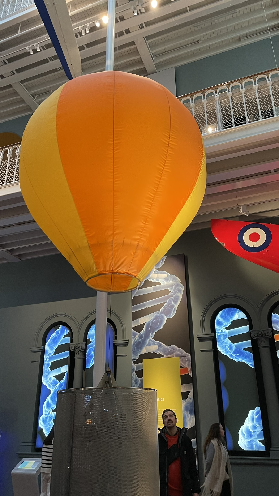

:::
:::

::: columns
::: {.column width="70%"}

#### Day 5 (Sunday)

Wow, it is only day 5! To start off the day, after some coffee, I visited the Surgeons Hall Museum. This was a maybe, I was visiting to see if there was anything that showed off the use of data. Their collections online are mainly to search for specific items not browse. One example I was hoping to find was use of data to track deaths/survivors from surgeries. This was not the case..... BUT.... I did find out that they are collecting public opinion on robotic surgeries in their newest exhibit that focuses' on that topic. At the start of the exhibit you respond to a single question on an iPad about your comfort of having a surgery performed on your with the help of a robot. At the very end of the exhibit they ask the identical question (there are also various questions in between). The museum has not also assured me they give me access to that data for my class. This may seem like a small excuse to visit this museum but I discuss this place again below.

Chocolate Tour - this was not a course visit but delicious. Of course out of my own pocket, but when in Rome (Edinburgh) you make chocolate - said nobody ever. But, the last time I visited Scotland I had the most amazing chocolate and hot chocolate from an award winning chocolatier at their shop in the middle of rural Scotland. I had to try again. The experience was very fun, I made some chocolate, tried many chocolates, and learned about the process of growing coco beans and eventually making the chocolate.

Many other things were closed on Sunday, I relaxed after this, did some reading of a book for the course, and researching for more places to visit. I learned something new. The architect of much of the city of Edinburgh was William Playfair.... who also happened to creator of the line, bar, area, and pie charts. Of course, this meant I needed try to see of of his work!

:::

::: {.column width="30%"}

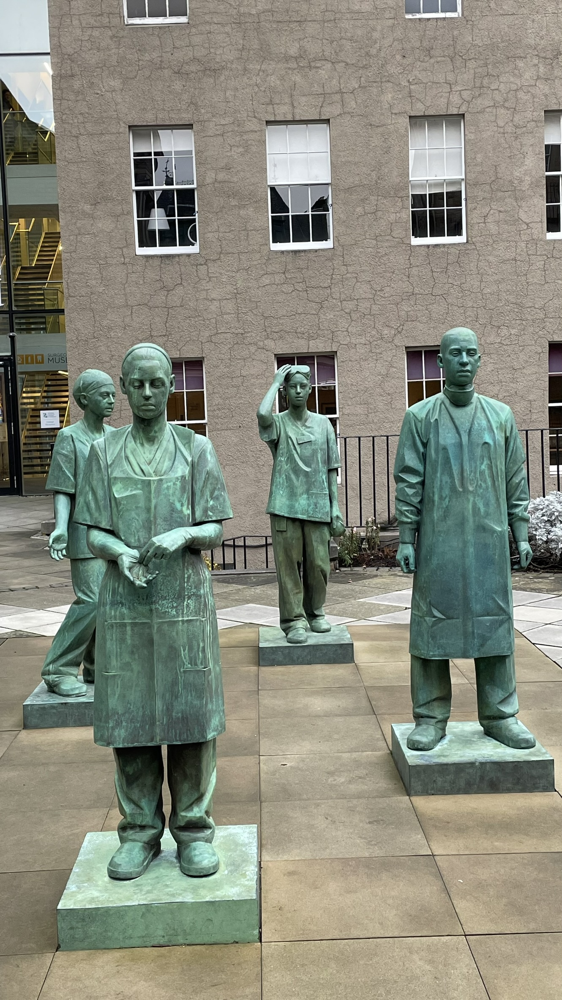

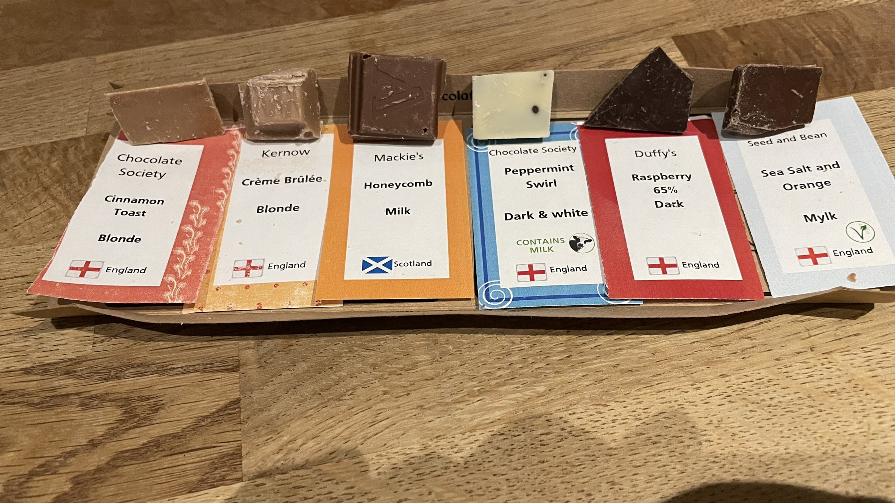

:::
:::

::: columns
::: {.column width="70%"}

#### Day 6

Finally a weekday again, almost everything was open! I started this day by going back to Royal College of Surgeon's - Edinburgh archives. I just, showed up, with no appointment. This is not standard but I was there and I knew they wouldn't check emails on the weekend. Their building, that I toured a few days before, was designed by Playfair, and they supposedly had some of his archives. I also wanted to speak to someone about the course. The receptionist called over to their assistant archivist, Mr Robin Fixter, and he was incredibly kind. He showed me to all the places of the building that had many of the archives and we discussed the use of data and statistics since the organizations inception in 1508! I learned many things quickly that I need to follow up on, two that I'll note here. 1) Their organization keeps *Minute Books* and in this building they date back to 1581. From the start they tabulated data and used it. 2) During the Crimean war two surgeons we leading the medical efforts and the death rate was much much higher than it was suppose to be. This lead these two down a path of collecting and using data to show that it wasn't their fault. Fixter also gave me contact information for the main archivist and said they would love for our class to visit for something more data focused.

Other parts of this day I walked around the city to scout out locations rather than meet with specific people. The first place was the Office of National Statistics. They are housed in 4 different buildings and even worse, two of them are under construction. It was a bit of maze but I found one of their offices and discussed my ideas with someone. They have me a direct email to someone (rather than a generic government email) and I look forward to organizing a learning visit soon.

I stopped by the City Art Centre of Edinburgh. I was planning on seeing an exhibit about data but it turned out that it hand not been up for multiple years. The gallery was focused on current art and showed winners of various recent art competitions in Scotland and Edinburgh. I played a VR art game that was fun experience. Another free visit but no course relevance at this time.

Since William Playfair clearly has had an important role I wanted to find his statue. I actually had already walked by it, right outside the National Museum of Scotland. I also attempted to walk to the National Galleries of Scotland - Portrait but ended up at the wrong branch. Their galleries are split across 3 buildings in slightly different parts of the city. I GPS'ed to the one I wanted, so I thought, but ended up at the wrong one. The art was beautiful but no portrait of Playfair. I'm sure we can find it next time; the galleries are free or else I wouldn't go just to see 1 portrait. I ran out of time before a scheduled meeting to visit the other gallery.

I ended this busy day with a meeting with faculty at Napier University that I had setup. Napier University is built around Napier Castle/Tower which was owned by John Napier who invented the Logarithm. This inspired my reaching out and Professor Khristin Fabian coordinating for me meet about 6 or 7 of their faculty. Four of us sat down together over coffee and had some really wonderful conversations about teaching, and research on teaching. This may yield a collaborative project between myself and of their faculty members; unrelated to the course. See more on my second meeting with their faculty below.

:::

::: {.column width="30%"}

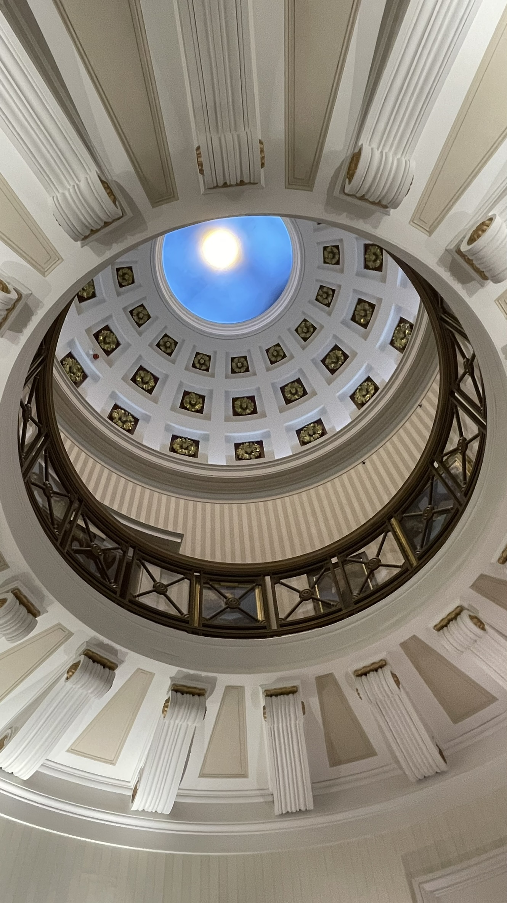

:::
:::

#### Day 7

Unknowing to each other, another faculty member at John Napier University reached out to me to meet, Professor Pete Barclay. We discussed specifics about the class I wanted to teach and maybe some 1 day collaborative work between some of their undergraduate students and hours when we visit. I will have to wait and see where that goes but we also ended up discussing a potential undergraduate research project for next summer! I do think we will visit in some capacity with the class but I'm not sure yet.

The remainder of my day was a 5 hour train to London. Very nice and easy to get on the train at Waverly Station.

::: columns
::: {.column width="70%"}

#### Day 8

The reminder of the trip was spent in London. This is where my trip got a little more sparse. In reality I don't think I needed a 14 day trip but due to the cost of the flight I chose being so low, it was cheaper to stay 14 days instead of the 10ish I had been aiming for. I still made the most of my time in London and walked the steps of my future students so I can prepare course materials.

To start, I visited the Florence Nightingale Museum. Considered one of the first women to contribute to the field of statistics in new methodology, Florence was a force to be reckoned with. She was a brilliant, passionate, and dedicated women in all of her endeavors. The museum captures a lot of this and does have a section that focuses on her contributes to statistics, though it leaves some things up to the imagination (I will fill in some gaps with lecture and seeing source document correspondents a the University College London archives when we are in the course). The museum is small but rather nice. This makes is easier for me to ask students to read and engage in everything, which is what I will do, along with a tour.

In the middle of the day, I decided to do some exploring and find a couple locations of significance. I located both the John Snow pub and 1854 Cholera Broad Street Pump replica. Our course on Epidemiology at Cornell reads Ghost Map which gives an in depth history of this location. We will likely just stop there with students. I will not be teaching this part of the course, Professor Ann Cannon, who teaching the Epidemiology course and is going on the trip has volunteered to do so. I still wanted verify locations since, you know, I was in London anyhow.

I closed of my work day by visiting the British Library and attached Alan Touring Institute. The library is in an amazing building and normally gives you access to reading rooms where you can have historical documents presented. Unfortunately, about a month prior to my visit, the British Library started getting cyber-attacked, and it is still ongoing. This meant all I could really do was visit the building. In the fall we will view some source documents they have related to the course. The Alan Touring Institute is primarily just a standard building with office and some instructional spaces. They host regular events in statistics, data science, and Machine learning. If they have an event during our trip I will try and plan it in but they did not while I was visiting (the day before I arrived).

:::

::: {.column width="30%"}

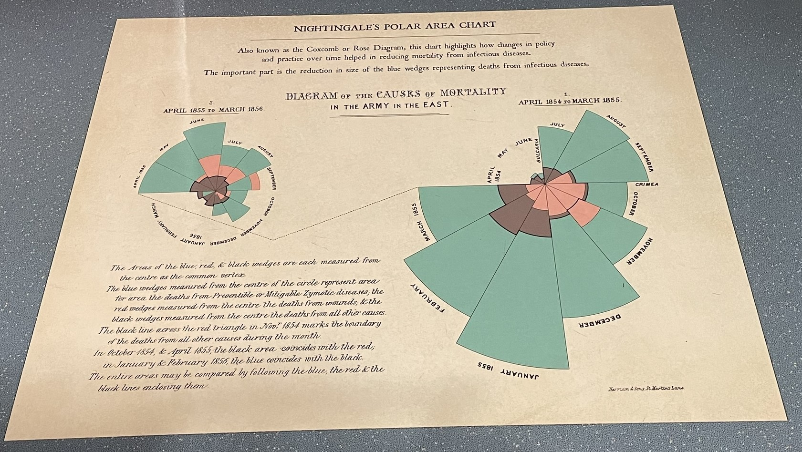

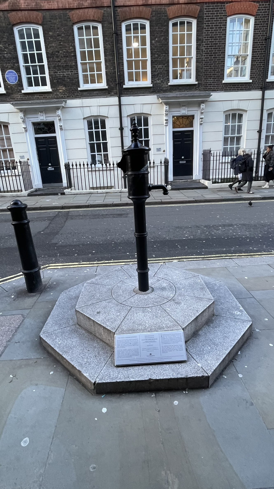

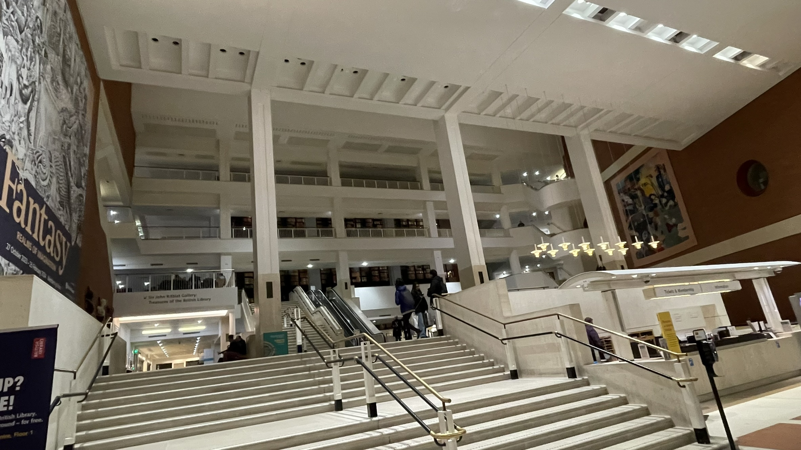

:::
:::

#### Day 9

The Science Museum is generally speaking spectacular. I was specifically looking for the Winton Gallery on Mathematics but everything was so intriguing I kept getting distracted while looking. The Winton Gallery is moderate in size and covers mostly mathematics, probability, some on data storage and use. What I needed from this visit was to know how it was laid out and what was in the exhibits. Like the other museums, their online archives are mostly for searching on very specific topic or artifact. I took pictures of every inch of the Winton gallery in order for me to plan around it. I also took note of many many names of scientists elsewhere in the museum that I found likely used data frequently in their work. Lastly, there is a large exhibit on medical care that overlaps with Florence Nightingale and covers Epidemiology historically and currently with exhibits on the Covid-19 pandemic. They used to have even more but it appeared they took some of the physical exhibits down mentioned on their website (without saying they did). This is one visit that was necessary to bein person in order for me to plan the course.

Rather than simply visit the Royal Statistical Society (RSS) building in London, I decided to go to a talk they were hosting, \`\`2023 Cathie Marsh Lecture - AI: A Game Changer for Social Research?" The event was great and had three speakers, Professor Helen Margetts, Dr Nicola Stingelin, and Andrew Banks. They are all active data scientists and researchers. What was even more valuable was the social hour after. I met folks working mostly in statistics/data science industries after and the folks who run the office of the RSS. Coincidentally, they actually emailed me back the following morning about the course - in person networking can be very effective!

::: {#fig layout-ncol=2}

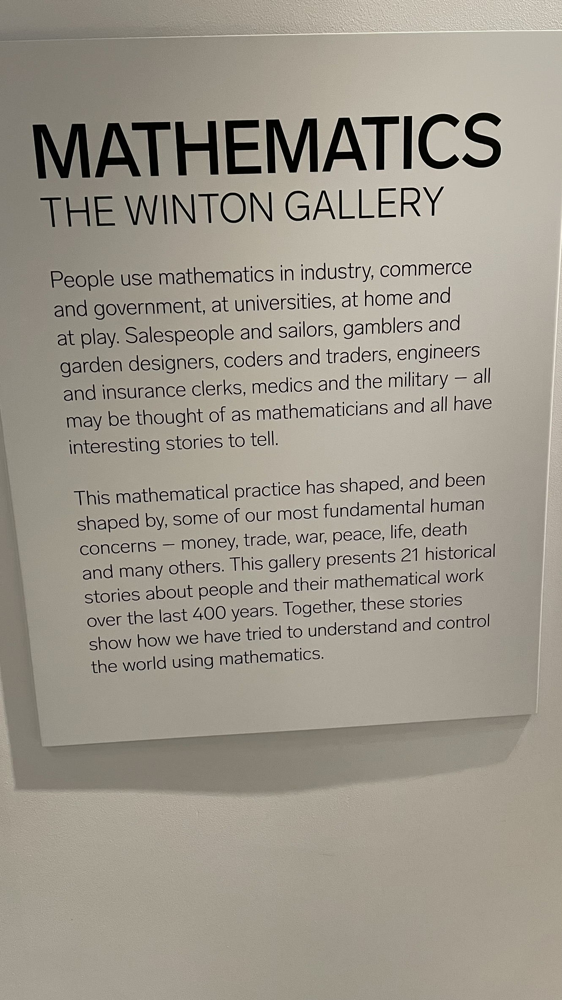

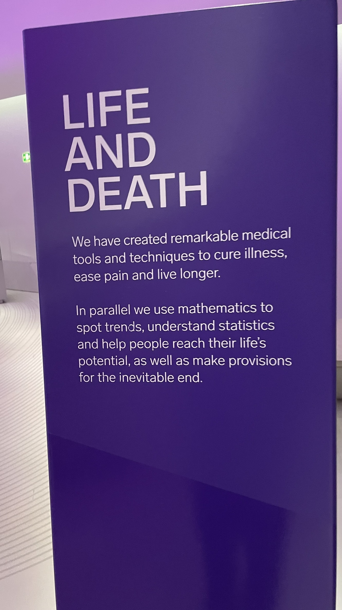

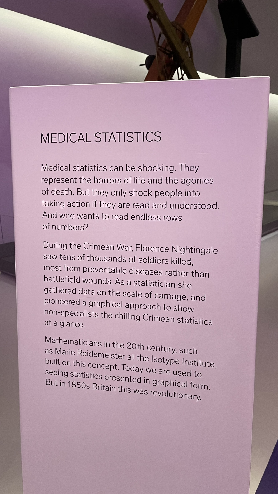

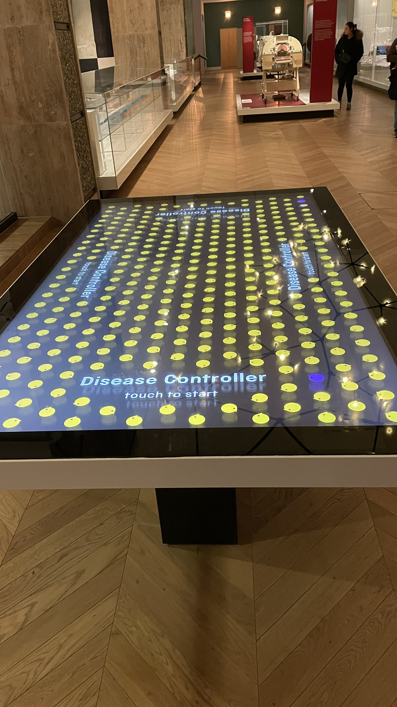

Science Museum, London
:::

::: columns
::: {.column width="70%"}

#### Day 10 - Kew

On this very rainy and cold day I made my way to Kew and visited the Royal Gardens and The National Archives. The gardens are, well gardens, but also includes a library and has active research in relevant fields. I spent hours exploring the gardens, mostly the indoor greenhouses, and taking pictures of the setup in the greenhouses, trying to decide if I would want to make instruction material for a visit. Though I certainly could, when we visit as a class we will spend 4-5 hours at The National Archives in one of their learning visits where they prepare the instruction. At this moment I think we will let students spend the time after the archives either at the gardens (for fun) or taking a train back to London to do something else. The gardens in Edinburgh (which were mostly closed during my visit) I know works with statisticians so I am hoping to have the class do a learning visit there (tentative right now). The nature of my current trips is, what should or should not be required in the course? I briefly visited The National Archives after walking 8 miles around the gardens (yes I am using miles even though I was in Kew). The person I was to meet with is out of work due to an injury.

:::

::: {.column width="30%"}

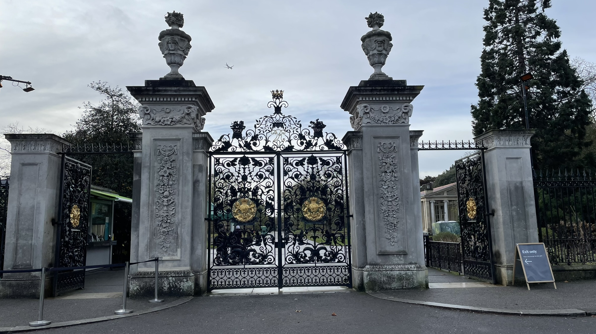

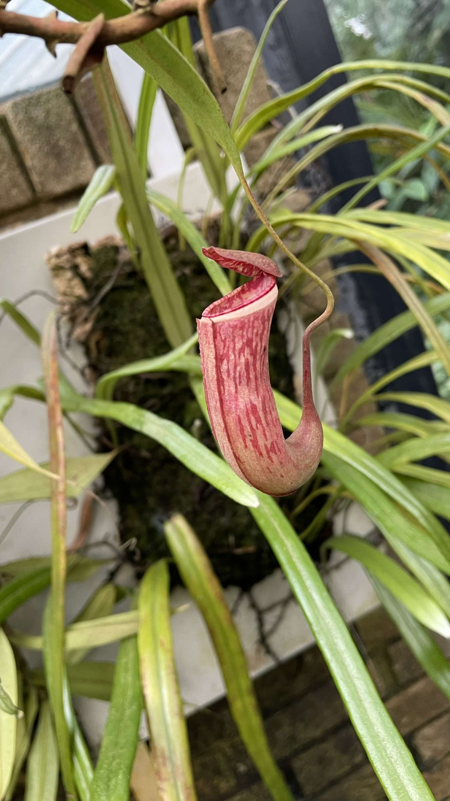

:::
:::

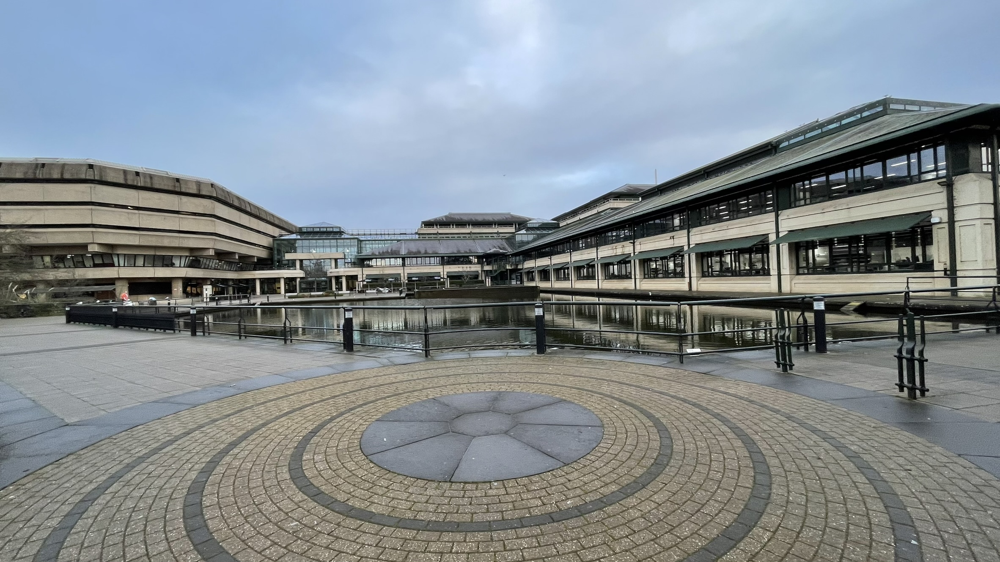

::: columns
::: {.column width="70%"}

#### Day 11 (Saturday) Bletchley

On my last Saturday I took a train to Bletchley and visited both Bletchley Park and National Museum of Computing. Bletchley Park is where WW2 code-breakers were housed and the enigma machine was developed. The museum is wonderful, with all the original buildings turned into exhibits. When we visit we will do a learning visit with them where they will give the history to students and have a focus on the mathematics and probability that was necessary in order to build the enigma machine. Even better, some the statisticians discussed in the Lady Tasting Tea (likely to be the courses primary text), Jack Good, got a start on his career at Bletchley Park. I really didn't knew what to expect in terms of relevance to my course there but the place as a whole has large emphasis on important WW2 history and the logic, mathematics, and probability involved in the work there. To me, this feels relevant to statistics.

I then walked down the road to the National Museum of Computing. This ones site is rather sparse so I was really entering with no expectations. The building it is house in looks about to collapse but whats inside is well worth the visit. The tie to statistics is only in that computing for statistics as it is today to exist at all. The museum has the oldest functional computer in the world and the guides there give a passionate history of generations of computers, starting with those with only mechanical parts, to modern computers today. You can choose to play old video game systems and some modern systems as well, they are in fact, the center of use of computers for entertainment. I do think students will very much enjoy a visit and it about 1 block on the same road from Bletchley Park.

:::

::: {.column width="30%"}

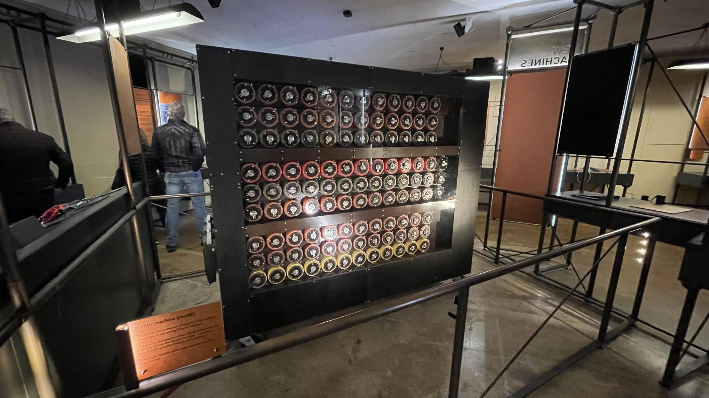

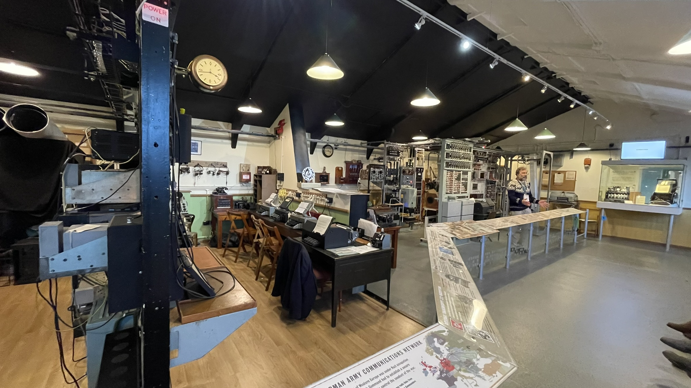

:::
:::

::: columns
::: {.column width="70%"}

#### Day 12 (Sunday)

At this point in my trip I was determined to make a good use of one of my last few days. I decided to start the day visiting the Victoria and Elbert Art Museum. I didn't expect this to be course related but since it has free entrance, maybe a location a student could visit on one of their free days in London. I was not disappointed and was blown away by the statues specifically. I enjoy art but do not claim to know much about it - and I genuinely enjoyed my visit. Beyond the statues I also enjoyed the jewelry exhibits.

I also visited the National History Museum for fun, which was very busy when I was there. The building is massive and cover's likely an entire city block. The best parts included seeing Darwin's original journals, dinosaur, moon-rocks, and the largest geological collection I've ever seen.

:::

::: {.column width="30%"}

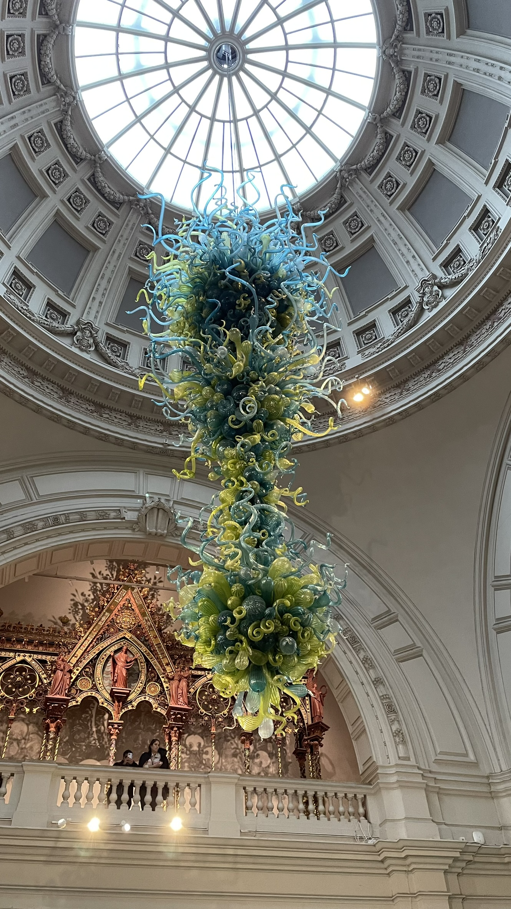

:::
:::

::: {#fig layout-ncol=2}

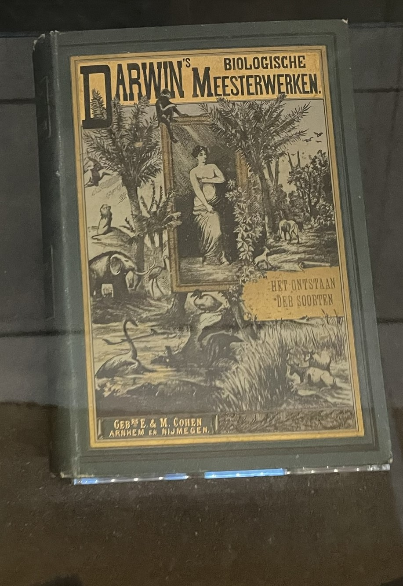

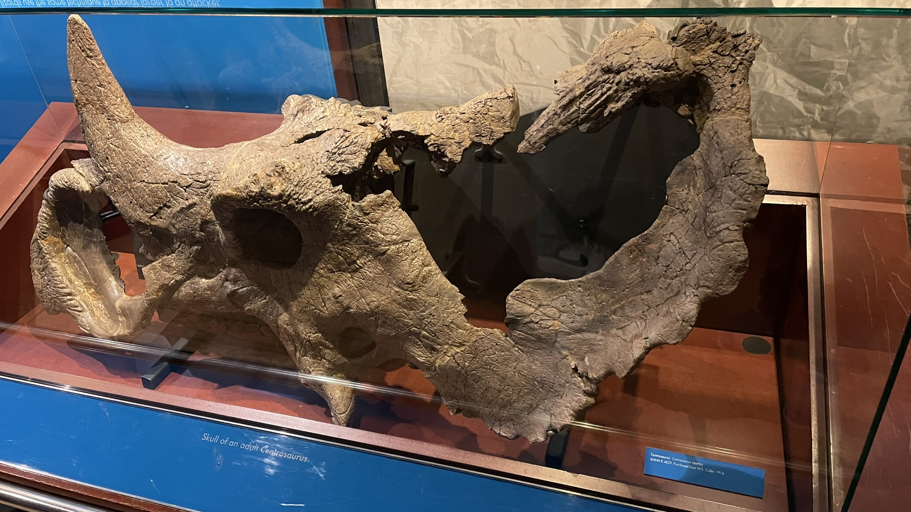

Natural History Museum, London
:::

::: columns
::: {.column width="70%"}

#### Day 13 (Monday)

My last day in the city I met with a educational representative of Fulham Football Club. They are a smaller team that still competes in the Premier Football League. Their stadium has both the oldest and newest stadium seats in all of the UK. They are also small enough to work with us to have one of their data analysis meet with our students and talk about how they have used and currently use data. They were very welcoming and gave me the full tour that students will also get to experience next year.

To fill out my last day I visited the British Museum. I'm rather sure my mouth actually dropped open when approaching this building. It is massive and it houses massive artifacts such as partial and recreations of ancient Egyptian temples. They have artifacts that are thousands of years old. I'm sure most students will enjoy a visit, again, during one of their free days.

Afterwards, I got a treat at an local ice cream place that makes their ice cream in house - Udderlicous. Great goodies in the ice cream but not the smooth-est. I would go again though!

:::

::: {.column width="30%"}

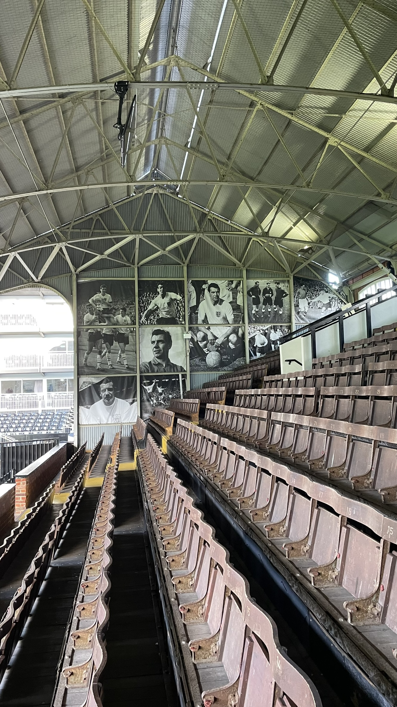

:::
:::

#### Day 14

Travel. 2:30am GMT: Bus -\> Train -\> Airport -\> Bus at Airport -\> Airport x 3 -\> Car Ride -\> Home with wife and dogs and my comfy bed at 9:45pm Central!

This closes off my overview of my trip to plan this course. Experiencing many of these locations, and collecting data and names in exhibits will be invaluable to make an organized, educational course and trip for my students. Of course, I will share it all in its own website to be linked here once it exists. Stay tuned!
