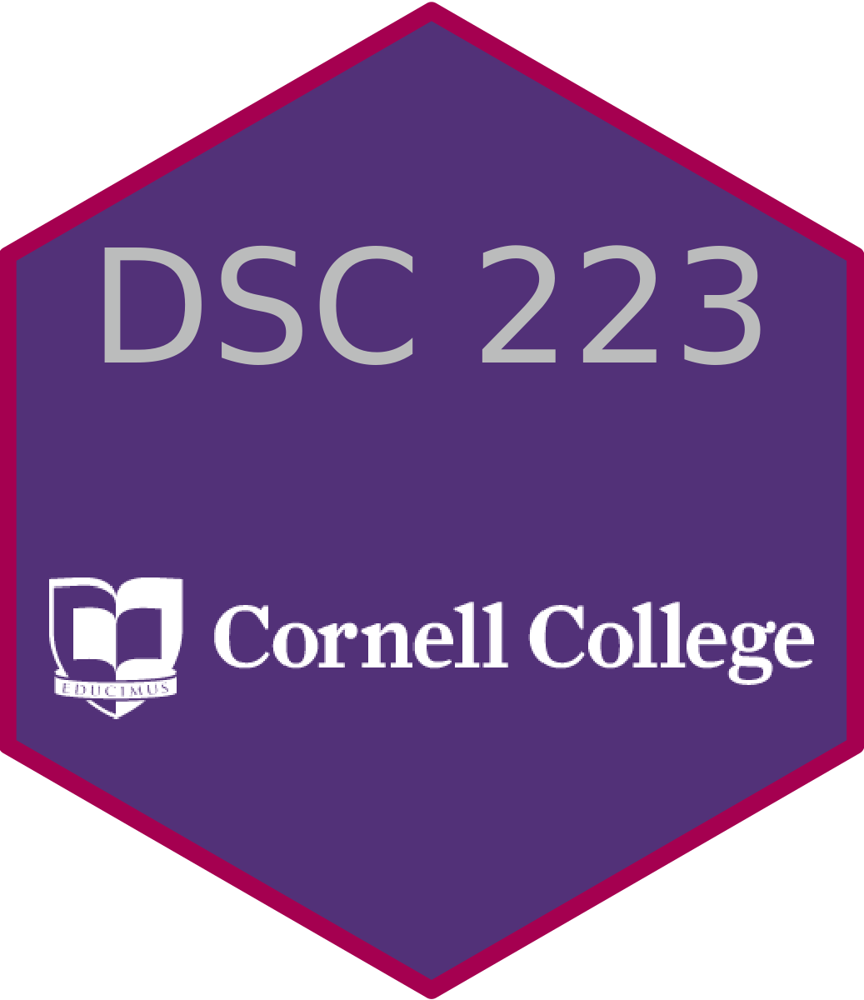

## Courses

### Statistical Methods I (STA 201)

Semesters: All of them

### Statistical Methods II (STA 202)

Semesters: Fall 2021, 2022

### Introduction to Data Science (DSC 223)

:::: {.columns}

::: {.column width="50%"}

Semesters: Fall 2022 Block 2, Fall 2021 Block 4
Course website: [dsc223-fb2-2022.github.io/website/](https://dsc223-fb2-2022.github.io/website/)

Topics have included data cleaning and wrangling, version control, data ethics, data visualizations, web scraping, and text analysis. The course is taught in R, using the free version of RStudio Server on a Cornell College campus computing cluster. Please reach out if you want more details! 

Course materials are primarily from [Data Science in a Box](https://datasciencebox.org/) by Mine Çetinkaya-Rundel. 

:::

::: {.column width="50%"}
[{width="225"}](https://dsc223-fb2-2022.github.io/website/)

:::

::::

### Introduction to Time Series (STA 364)

Semesters: Spring 2021, 2023

### Advanced Regression (STA 363)

Semester: Spring 2021

### Statistics and Data Science Capstone (STA 484 and STA 502)

Semester: Co-facilitated in 2021-2022

