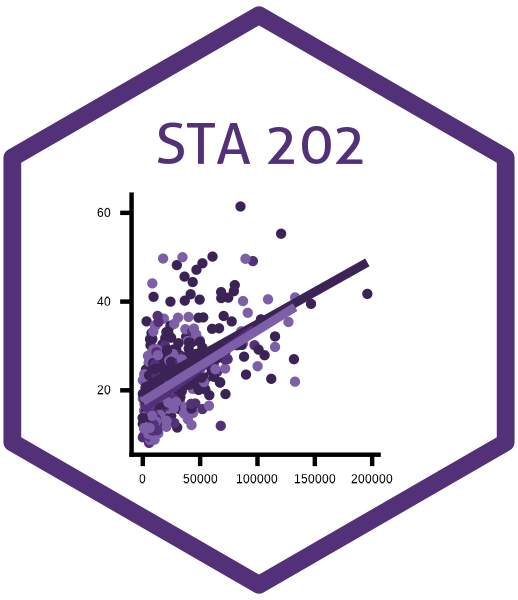
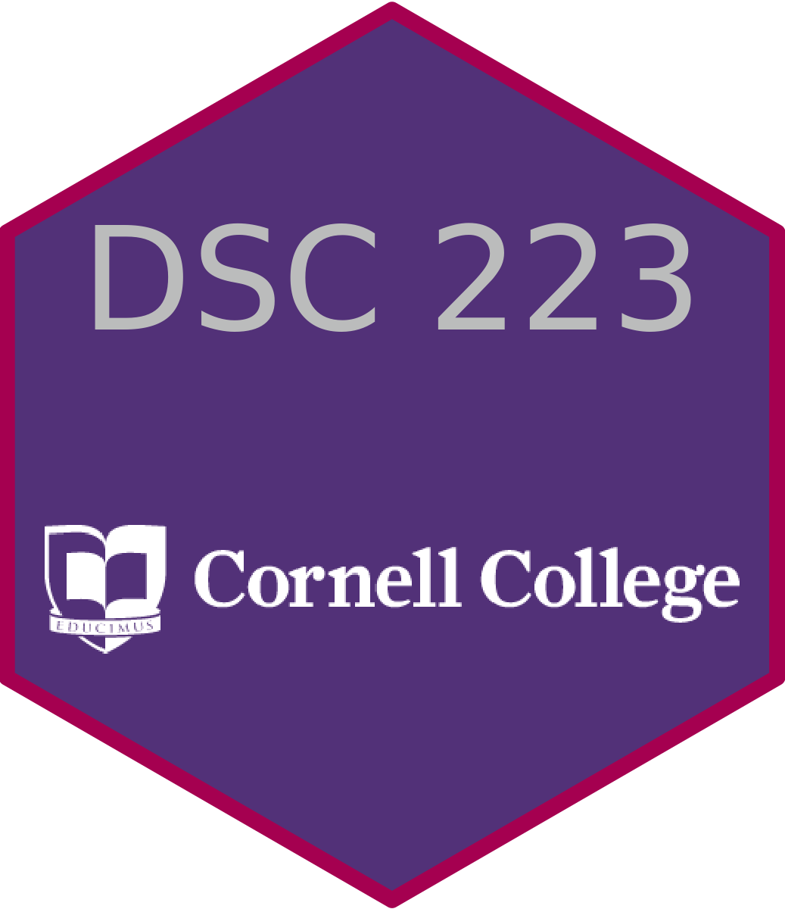
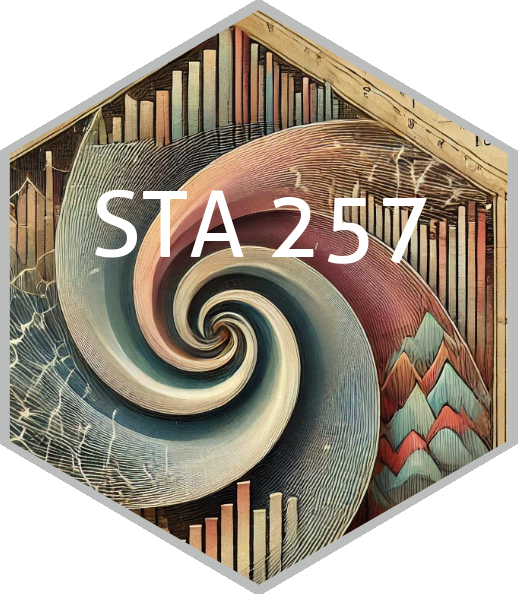
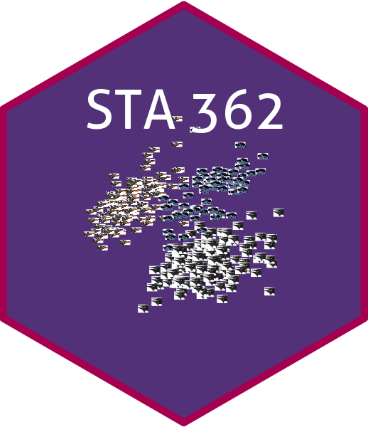
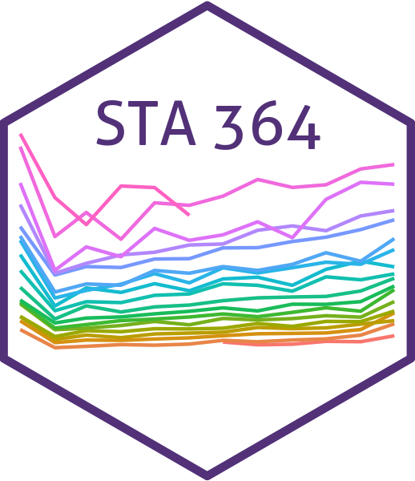

### Community Engaged Statistics and Data Science (STA 200)

::::: columns
::: {.column width="70%"}
Semesters: Fall 2025 Block 1, Fall 2023 Block 1

Course Website: [stats-tgeorge.github.io/STA200_S4E](https://stats-tgeorge.github.io/STA200_S4E/course-description.html)
Course Website: [stats-tgeorge.quarto.pub/sta-200-stats4sj](https://stats-tgeorge.quarto.pub/sta-200-stats4sj/)

This course changes each time I teach it because it is based on which community partners I work with (so far Waypoint Services) and what the community partner needs are. This is also not normal statistics course; rather than it falling in the statistics curriculum, it is part of our colleges core curriculum, as a course that has a focus on civic engagement. As a statistician, I decided what better way for my students to give back to the community than to help them with their data questions. The specific content changes each time but each time I still heavily emphasize 1) data context knowledge, 2) basic statistics through descriptive statistics, 3) project engagement, 4) communication, and 5) citizenship. Since each class is so different, I offer both their course descriptions below, though, I would encourage you to look through their websites. You get to see some of he final student output to the partners. 

**Fall 2025 Course Description:** This course will examine factors impacting Iowans’ engagement with Waypoints services. The course will include (1) learning the descriptive statistics needed to investigate data, (2) communicating with Waypoint representatives to establish straightforward research questions, learning what data need to be collected and how to access various databases, (3) completing the analysis of their data, and (4) present your findings. We may go off-campus to present our findings to Waypoint and participate in other relevant activities. Everybody must sign a confidentiality agreement to participate in this course, as we will be working with private data.

**Fall 2021 Course Description:** How equitable are housing services in Iowa? In this course we will seek to understand the intersection of race and housing services. We will be collaborating with the Iowa non-profit Waypoint to identify which communities are most affected, and which housing services have the largest racial disparities. The course will include: (1) reading about and discussing the historical role race has played in Iowa housing; (2) learning the descriptive statistics needed to investigate data; (3) communicating with Waypoint representatives to establish clear research questions, learn what data they collect and how to access their database; and (4) complete the analysis of their data. Students will work in groups throughout the block to investigate different data and answer different questions. There may be small group visits to some off campus locations to gather data currently only available on paper.
:::

::: {.column width="30%"}
[{width="225"}](https://stats-tgeorge.quarto.pub/sta-200-stats4sj/)
:::
:::::

### Statistical Methods I (STA 201)

Semesters: All of them

I teach this course using a combination of simulation and traditional methods from the Lock5 book ["Statistics: Unlocking the Power of Data."](https://www.lock5stat.com/) I understand the jury is still out on which approach is best when teaching statistics but I can speak from at least a few years of experience teaching each way. The simulation methods bootstrapping and randomization) are easier for me to explain, and lend themselves to fun activities for students to learn through. Specifically, the concept of a sampling distribution really clicks for my students when learning through bootstrapping.

I use a combination of the author's free online StatKey product and JMP as statistical software. I have also been using the WileyPlus platform (paid) for the very nice eBook, and assigning the skill builder questions from the homework. Students complete the other exercises and present them in class the following day. This gives students a nice mix of some immediate feedback and delayed feedback and allows them to only try the more challenging questions after they have been successful online.

Stay tuned for a new version of this course using online games to introduce every unit, planned for spring 2027.

### Statistical Methods II (STA 202)

::::: columns
::: {.column width="70%"}

Semesters: Spring 2021 Block 5 (online), Fall 2021 Block 4 (hybrid), Fall 2022 Block 4, Fall 2025 Block 4

Course website: [stats-tgeorge.github.io/STA202_Stat2F25](https://stats-tgeorge.github.io/STA202_Stat2F25/)

This course starts where STA 201 leaves off, having students explore connections between t-tests and linear regression models. It then covers multiple linear regression, one and two way ANOVA, logistic regression, and other topics mixed in such as Levene's test for equal variances. We use the STAT2 Modeling with Regression and ANOVA by Cannon, et. al. book. 

This course took me a few try to get *good* at teaching. There is a noticeable increase in difficulty from STA 201 to STA 202. STA 201 we serve a general audience of students across disciplines, but in STA 202, we generally are serving STEM students. This is the first course were students experience some sophistication in statistics.  It took me a little while to find a way to help students make this leap. Still not perfect, but, my last iteration my class and I felt good at the end. I made it two thirds into the class with 0 unexcused absences - students were enjoying the course! 

:::

::: {.column width="30%"}
[{width="225"}](https://stats-tgeorge.github.io/STA202_Stat2F25/)
:::
:::::

### Introduction to Data Science (DSC 223)

::::: columns
::: {.column width="70%"}
Semesters: Spring 2024 Block 7, Fall 2022 Block 2, Fall 2021 Block 4

Course website: [dsc223-sb7-2024.github.io/DSC223_S24_website](https://dsc223-sb7-2024.github.io/DSC223_S24_website/)
Course website: [dsc223-fb2-2022.github.io/DSC223_F22_website](https://dsc223-fb2-2022.github.io/DSC223_F22_website/)

Topics have included data cleaning and wrangling, version control, data ethics, data visualizations, web scraping, and text analysis. The most notable development for this course was the changing of our pre-requisites from *either* intro statistics OR intro to computer science to a single pre-requisite of STA 201 (intro statistics). This was mainly due to my difficulties teaching a class with completely different backgrounds and the changing of the purpose of this course. When it was first created (before my time) it was strictly an elective, and, the whole class was completed with student groups that were constructed to have diverse skill sets. In my second year at Cornell College, we created two new majors in Applied Statistics and Data Science. This course (DSC 223) now was a core course for both majors and, as such, we needed a more uniform expectation of students taking the course. While group work is still heavily used (as is with data scientists), students have components, including homeworks and exams, that are individual. 

The course is taught in R, using the free version of RStudio Server on a Cornell College campus computing cluster. Please reach out if you want more details!

Course materials are primarily from [Data Science in a Box](https://datasciencebox.org/) by Mine Çetinkaya-Rundel.

**Course Description** Managing and interpreting an overwhelming amount of raw data is part of the foundation of our information society and economy. People use computers and statistics to translate, process, and visualize raw data, enabling new understandings that in turn contribute new knowledge to the world. Data Science is a newly developing field that merges ideas from both statistics and computer science to address these issues. In this course statistics will inform the discussion about what appropriate goals are for learning from the data and how the data will answer the questions raised. The computer science perspective will help us figure out which goals are actually feasible computationally, and how to achieve them.
:::

::: {.column width="30%"}
[{width="225"}](https://dsc223-sb7-2024.github.io/DSC223_S24_website/)
:::
:::::

### History of Statistics in the UK and Ireland (STA 257)

::::: columns
::: {.column width="70%"}
Semesters: Fall 2024 Block 1

Course website: [bit.ly/STATS_UKnIR](https://stats-tgeorge.quarto.pub/history-of-stats-uk-ireland/)

**Course Description** In this course students will walk the path of historical statisticians in the United Kingdom and the Republic of Ireland, both physically and in thought. Students will learn about, and critique the reasoning of, the founders of statistics, their circumstances, and sometimes flawed reasoning, that led to the creation of major statistical concepts such as correlation and hypothesis testing. Students will additionally learn about, and engage with, cryptography, data visualization, early computers, epidemiology, experimental design, gathering of information, sports statistics, and the role statistics played in the eugenics movement.
:::

::: {.column width="30%"}
[{width="225"}](https://stats-tgeorge.quarto.pub/history-of-stats-uk-ireland/)
:::
:::::

### Statistical Learning (STA 362)

::::: columns
::: {.column width="70%"}

Semester: Spring 2026 Block 8, Spring 2024 Block 8

Course website: [stats-tgeorge.github.io/STA362StatLearning](https://stats-tgeorge.github.io/STA362StatLearning/)

First, I'll note that this course is be redesigned and relabeled as a Advanced Data Science course. I've taught this course a few times now and my students **love** it! The course is taught out of [An Introduction to Statistical Learning with Applications in R](https://hastie.su.domains/ISLR2/ISLRv2_corrected_June_2023.pdf.download.html) by Gareth James, Daniela Witten, Trevor Hastie, and Robert Tibshirani. We cover roughly the first half of the book but with coding differences. We focus of conceptual understandings of methods like Naive Bayes, Random Forests, and many more since there is no mathematics pre-requisite like calculus. We use **tidyverse** and **tidymodels** for almost every model. Check it out if you are not familiar. It is a *replacemnt* for **caret** (the author of **caret**, Max Kuhn, works on **tidymodels.**)

This website design and all the R *tidymodels* code is based on [STA 363](https://sta-363-s23.github.io/website/) by Dr. Lucy D’Agostino McGowan, who used materials from ESPM-157 by Carl Boettinger, Sta199 by Mine Çetinkaya-Rundel, and PMAP 8521 by Andrew Heiss. See the website GitHub for more details. 

:::

::: {.column width="30%"}
[{width="225"}](https://stats-tgeorge.github.io/STA364_TSApps/)
:::
:::::

### Advanced Regression (STA 363)

::::: columns
::: {.column width="70%"}

Semester: Fall 2025 Block 3, Spring 2025 Block 8, Spring 2021

Course website: [stats-tgeorge.github.io/STA363_AdvRegF25](https://stats-tgeorge.github.io/STA363_AdvRegF25/syllabus.html)
Course website: [stats-tgeorge.github.io/STA363_AdvRegS25](https://stats-tgeorge.github.io/STA363_AdvReg/syllabus.html)

This is our 3rd course in Regression. Generally, it covers muli-level (random effect) models, but, like the transition from STA 201 to STA 202, it also represents a jump in sophistication for the students. They are expected to be much more independent, and self motivating data-explorers. The main textbook is: [Beyond Multiple Linear Regression](https://bookdown.org/roback/bookdown-BeyondMLR/) by Paul Roback and Julie Legler – it is freely available online. Chapters 1-9. The secondary text is: [An Introduction to Statistical Learning with Applications in R](https://hastie.su.domains/ISLR2/ISLRv2_corrected_June_2023.pdf.download.html) by Gareth James, Daniela Witten, Trevor Hastie, and Robert Tibshirani – it is freely available online. Chapter 7.

**Course Description** Following a second regression course, this class will begin with a review of multiple linear regression, but now using R. New topics will include probability distributions, likelihoods, differentiating binary vs binomial logistic regression, and poisson regression including its variants. The class of generalized linear models will then be presented which unifies all past modeling approaches. All methods are presented using realistic case studies. Conducting and communicating the modeling process including exploratory data analysis, model exploration and selection, and inferences are all emphasized. 

:::

::: {.column width="30%"}
[{width="225"}](https://stats-tgeorge.github.io/STA363_AdvRegF25/syllabus.html)
:::
:::::

### Introduction to Time Series (STA 364)

::::: columns
::: {.column width="70%"}
Semesters: Spring 2021, 2023, 2025 Block 5

Course website: [stats-tgeorge.github.io/STA364_TSApps](https://stats-tgeorge.github.io/STA364_TSApps/)

If you are considering adding an undergraduate course, or changing your existing course, this was my experience in that process. This course currently falls in an interesting place in Cornell's curriculum. Originally this was a topics course that we wanted to make sure was going to be accessible by a large variety of students. The first iteration of the course only had an introductory statistics prerequisite and was a 200 level undergraduate course. The second iteration, we raised the course number to 300. The class was still too limited in scope by only having a single prerequisites and the fourth iteration of the course will now both be 300 level and have two statistics course prerequisites.

The newest edition to those course was the website and the course project to be around **Scrollytelling**. I encourage you to check it out on the site. Most students agreed to share [their final stories](https://stats-tgeorge.github.io/STA364_TSApps/project/project.html) on the website. 

In spring of 2022 I chose to use a book I ended up relying on, as a secondary reference, during my 2021 iteration of the course, ["Forecasting: Principles and Practice (3rd ed)"](https://otexts.com/fpp3/) by Hyndman and Athanasopoulos. I made this decision because the book clearly required less mathematics than my previous used book (see below). That being said, it also uses more R code and gives extremely brief introductions to some more advanced concepts. There was an R learning curve for about 1/3 of the course but beyond that almost all functions were repeated or modified from previous examples.

I enjoyed the text and the authors include notes that you modify, and solutions to all of the homework assignments (after you confirm your are an instructor). My favorite section of the book was their explanation, using diagrams of the algorithm the ARIMA function users when selecting a best model using AICc. As a side note, the authors use tidyverse friendly time series R code, primarily **fable** but offer their own package, **fpp3** to make it easy to teach your course with.

In spring of 2021 I used ["Introductory Time Series with R"](https://www.amazon.com/Introductory-Time-R-Use/dp/0387886974) by Cowpertwait and Metcalfe. The preamble of this book indicates it is appropriate for an undergraduate with only introductory statistics knowledge. This was mostly true for the content in the chapters but was not true, for the students in my classroom, when it came to completing most of the exercises. Both myself, and my student evaluations agreed that the text's primarily limitation was the lack of applied exercises. This book uses base R time series tools and is not tidyverse friendly.

**Course Description** Time series analysis is a vital tool for investigating data from many fields, such as business, economics, engineering, biology, medicine, social sciences, and politics. Understanding and anticipating a variable’s change over time is valuable. This class will cover an array of time series methods, including those for correlation analysis and forecasting, stochastic models, regression analysis with time-related variables, and stationary/nonstationary models.

:::

::: {.column width="30%"}
[{width="225"}](https://stats-tgeorge.github.io/STA364_TSApps/)
:::
:::::

### Statistics and Data Science Capstone (STA/DSC 484 and STA/DSC 502)

Semester: Facilitated 2024-2025, Co-facilitated in 2021-2022

Our department has struggled in the past with clarifying capstone expectations with students. In the fall of 2024, we co-developed rubrics for mathematics, statistics, and data science project tracks for students. Please reach out individually to request these to be shared. 
