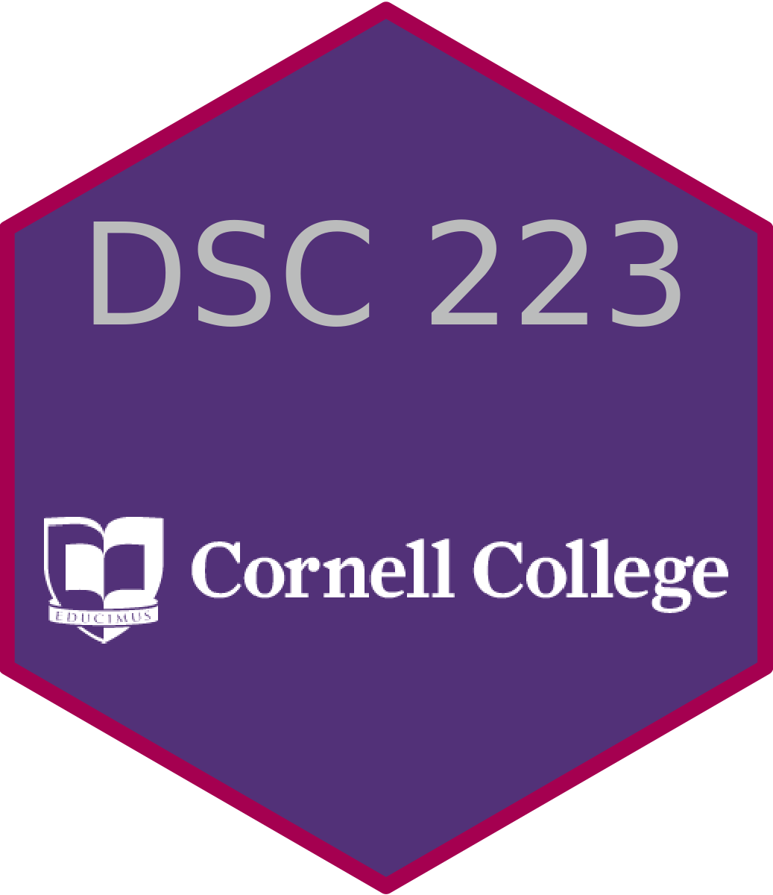

### Statistical Methods I (STA 201)

Semesters: All of them

I teach this course using a combination of simulation and traditional methods from the Lock5 book ["Statistics: Unlocking the Power of Data."](https://www.lock5stat.com/) I understand the jury is still out on which approach is best when teaching statistics but I can speak from at least a few years of experience teaching each way. The simulation methods bootstrapping and randomization) are easier for me to explain, and lend themselves to fun activities for students to learn through. Specifically the concept of a sampling distribution really clicks for my students when explaining using bootstrapping. 

I use a combination of the authors free online StatKey product and Minitab as statistical software's. I have also been using the WileyPlus platform (paid) for the very nice eBook, and assigning the skill builder questions from the homework. Students complete the other exercises and present them in class the following day. This gives students a nice mix of some immediate feedback and delayed feedback and allows them to only try the more challenging questions after they have been successful online.  

### Statistical Methods II (STA 202)

Semesters: Fall 2021, 2022

### Introduction to Data Science (DSC 223)

:::: {.columns}

::: {.column width="50%"}

Semesters: Fall 2022 Block 2, Fall 2021 Block 4
Course website: [dsc223-fb2-2022.github.io/website/](https://dsc223-fb2-2022.github.io/website/)

Topics have included data cleaning and wrangling, version control, data ethics, data visualizations, web scraping, and text analysis. The course is taught in R, using the free version of RStudio Server on a Cornell College campus computing cluster. Please reach out if you want more details! 

Course materials are primarily from [Data Science in a Box](https://datasciencebox.org/) by Mine Çetinkaya-Rundel. 

:::

::: {.column width="50%"}
[{width="225"}](https://dsc223-fb2-2022.github.io/website/)

:::

::::

### Introduction to Time Series (STA 364)

Semesters: Spring 2021, 2023

If you are considering adding an undergraduate course, or changing your existing course, this was my experience in that process. This course currently falls in an interesting place in Cornell's curriculum. Originally this was a topics course that we wanted to make sure was going to be accessible by a large variety of students. The first iteration of the course only had an introductory statistics prerequisite and was a 200 level undergraduate course. The second iteration, we raised the course number to 300. The class was still too limited in scope by only having a single prerequisites and the fourth iteration of the course will now both be 300 level and have two statistics course prerequisites. 

In spring of 2022 I chose to use a book I ended up relying on, as a secondary reference, during my 2021 iteration of the course, ["Forecasting: Principles and Practice (3rd ed)"](https://otexts.com/fpp3/) by Hyndman and Athanasopoulos. I made this decision because the book clearly required less mathematics than my previous used book (see below). That being said, it also uses more R code and gives extremely brief introductions to some more advanced concepts. There was an R learning curve for about 1/3 of the course but beyond that almost all functions were repeated or modified from previous examples. 

I enjoyed the text and the authors include notes that you modify, and solutions to all of the homework assignments (after you confirm your are an instructor). My favorite section of the book was their explanation, using diagrams of the algorithm the ARIMA function users when selecting a best model using AICc. As a side note, the authors use tidyverse friendly time series R code, primarily **fable** but offer their own package, **fpp3** to make it easy to teach your course with.  

In spring of 2021 I used ["Introductory Time Series with R"](https://www.amazon.com/Introductory-Time-R-Use/dp/0387886974) by Cowpertwait and Metcalfe. The preamble of this book indicates it is appropriate for an undergraduate with only introductory statistics knowledge. This was mostly true for the content in the chapters but was not true, for the students in my classroom, when it came to completing most of the exercises. Both myself, and my student evaluations agreed that the text's primarily limitation was the lack of applied exercises. This book uses base R time series tools and is not tidyverse friendly. 

### Advanced Regression (STA 363)

Semester: Spring 2021

### Statistics and Data Science Capstone (STA 484 and STA 502)

Semester: Co-facilitated in 2021-2022

